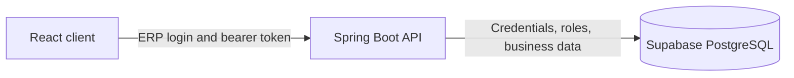

# System overview

The application is a single-company modular monolith. React calls the Spring Boot API; only the API accesses Supabase PostgreSQL. The ERP API owns email/password authentication and issues signed bearer tokens. Supabase Auth is not used for login.

The foundation profile runs without database credentials for a status-only smoke test. Business modules require the normal profile and an active ERP account.
